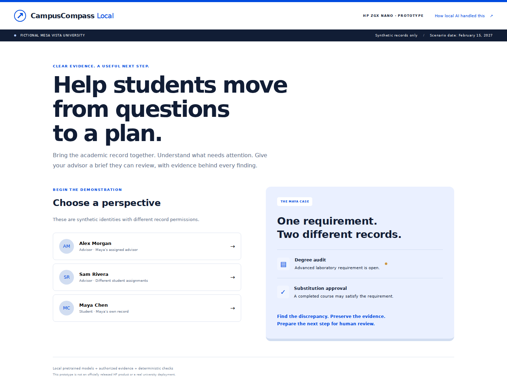

# CampusCompass Local

A synthetic university-advising demonstration that reconciles degree-audit evidence, approved substitutions and policy records into a cited brief for human review.

**Maturity:** Demonstration prototype. Permission checks, deterministic academic calculations, provenance and API isolation tests pass. Frontend production build passes. New inference and physical offline/reboot rehearsals were not run during portfolio preparation.

*Initial synthetic view; model inference and background processing were not exercised for this image.*

## How it works

React/TypeScript UI → FastAPI → canonical synthetic JSON and SQLite run state → scoped retrieval, local embeddings and reranking → local writer → deterministic claim release checks → ReportLab PDF and advisor review. Student/advisor permission checks precede retrieval and exports.

## Getting started

Read [installation, configuration and shutdown](docs/OPERATIONS.md) and [model/data retrieval](docs/MODELS.md). Review [dependency evidence](docs/DEPENDENCIES.md) before choosing an environment. The safe review launcher uses loopback and does not install services or load models.

## Security and data

Read [security and safe updates](SECURITY.md) and [ownership/license status](docs/LICENSE-STATUS.md). Runtime originals are preserved separately. This is a sanitized source snapshot with new history: no account state, business records, model weights, unknown media assets or original logs/history are distributed. Third-party notices included in this copy remain applicable.

## Verification

See [verification evidence and limitations](docs/VERIFICATION.md). Tests distinguish synthetic/mocked workflows from live integrations. Original demo screenshots and document recordings are excluded; use the synthetic workflow in the operations guide for your own reviewed demonstration.

## Roadmap

Add deployment-specific identity integration, institution-approved data import and independent evaluations only after explicit privacy review; complete physical disconnect and reboot rehearsal. Keep final advising decisions with a human.

For route/source details see [architecture](docs/ARCHITECTURE.md).
